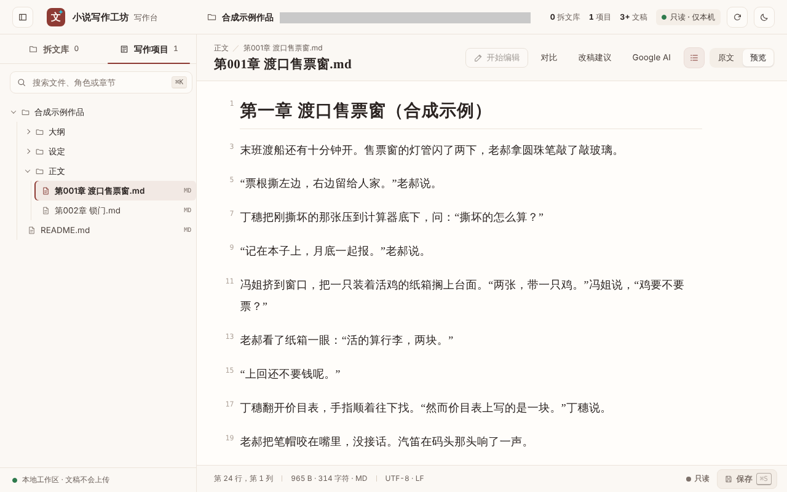
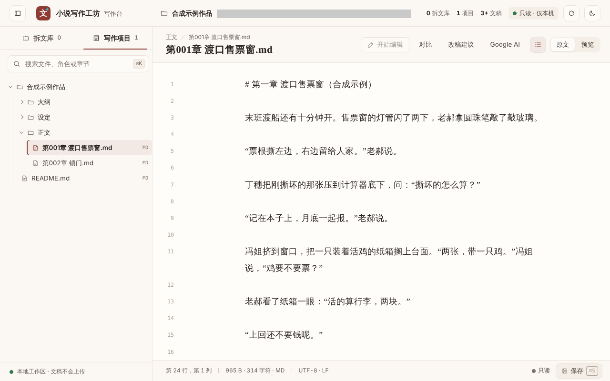
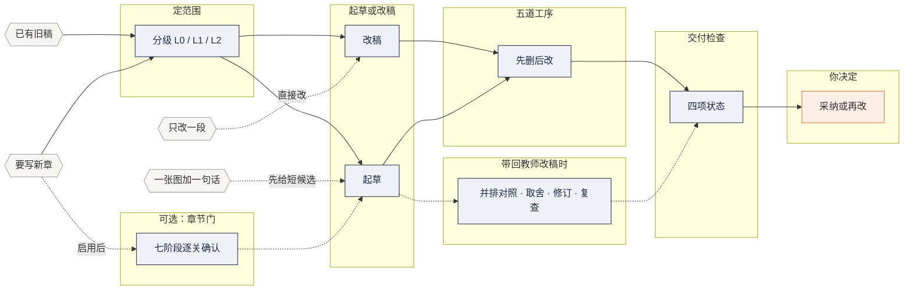

<p align="center">
  
</p>

<h1 align="center">小说写作工坊</h1>

<p align="center">
  <b>中文小说写作方法：设定、大纲、正文、改稿、审稿、连贯性，你用哪个 AI，就让哪个 AI 照着做。</b>
</p>

<p align="center">
  <a href="#下载与安装"><b>下载</b></a>
  &nbsp;·&nbsp;
  <a href="#安装后的第一条请求"><b>第一条请求</b></a>
  &nbsp;·&nbsp;
  <a href="#看看实际效果"><b>实际效果</b></a>
  &nbsp;·&nbsp;
  <a href="#常见问题"><b>常见问题</b></a>
  &nbsp;·&nbsp;
  <a href="docs/usage.md"><b>详细用法</b></a>
</p>

<p align="center">
  <a href="https://github.com/rumpelpalmour757-lgtm/novel-workshop/stargazers"></a>
  <a href="docs/versions.md"></a>
  
  <a href="docs/style-cards.md"></a>
  
  <a href="LICENSE"></a>
</p>

<p align="center">
  <a href="portable-novel-workshop.md"></a>
  <a href="novel-workshop-commercial-r5.55.zip"></a>
</p>


## 这是什么

小说写作工坊是一套写给 AI 读的中文小说写作方法，主流程是：**给材料 → 定范围 → 起草或改稿 → 五道工序查改 → 交付检查 → 你决定采不采纳**。它是一组文件：聊天产品用便携单文件，能装技能的工具用完整包。工坊不带模型，谁来写取决于你用的那个 AI；包里也不含账号和额度。

- **方向由你定** — 人物去哪里、哪一版算定稿，由你决定；AI 按这一轮的任务起草或改稿。你说「采纳这一版」之前，交出来的都是候选稿。
- **改稿两头对照** — 改完和原稿对着读，随稿附几行说明：改了什么、保住了什么、哪些没核。没跑的检查写「没跑」，不写「通过」。
- **按任务取用，不走全套** — 改几句只读一篇方法；整章才查断句、标点、事实和修订前后对照；多章先试一章给你看。共 48 篇方法参考、83 张风格卡。
- **四个可选模块，默认都不开** — 章节门（写新的一章时七关逐关确认） · 学习循环（意见、取舍、改稿、复查留记录） · 示范记忆（最多取三条认可过的改法） · 对白声纹与反模式检查（只标要回去读的句子）。

> **方向由你定；没做的检查，不写成做了。**

上面写的是工坊让 AI 照着做的方法，不是效果保证。唯一一次和不用工坊的 AI 比（r5.46，小规模，执行和评审都是同一类模型）：改 AI 腔重的稿子，排第一的都是不用工坊的；从头起草时工坊多数在前。之后没有再比过。对白是不是更像人、更有感情，没有验证，好不好由你读了定。

工坊只在你提出请求时工作，不会在后台自己写。

## 下载与安装

**Codex** — 默认装到 `~/.codex/skills`

```bash
python install.py --dry-run
python install.py
```

**Claude Code** — 装到个人技能目录

```bash
python install.py --dry-run --dest "~/.claude/skills"
python install.py --dest "~/.claude/skills"
```

两块二选一，每块第一条只预览、不写文件。先下载[完整包](novel-workshop-commercial-r5.55.zip)（约 3.5 MB）并解压，在解压出来的目录里运行；要 Python 3.9 或更新，找不到 `python` 就换成 `python3`。点下载链接会打开 GitHub 的文件页，再点页面右上角的下载按钮保存。

**升级用 `python install.py --upgrade`。** 装的时候带了 `--dest` 的，升级也带同一个 `--dest`；先加 `--dry-run` 看输出，技能后面写 `upgrade` 或 `unchanged` 才对，写 `install` 说明目录指错了。装在 Claude Code 里的，就是 `python install.py --dest "~/.claude/skills" --upgrade`。

**只能聊天也能用，不用装 Python，也不用自己配 API**：下载[便携单文件](portable-novel-workshop.md)（约 1.2 MB），传给 AI，再发这一句：

```
请读取附件中的小说写作工坊说明，
并在本次对话中按其中适用的方法处理我的写作任务。
如果有内容无法读取，请先说明。
```

用安装脚本装好的，装完**新开对话**，先让它确认读得到工坊的说明，再发任务；现成的请求见[安装后的第一条请求](#安装后的第一条请求)。

> 各环境怎么导入、不想跑脚本时怎么手动导入、怎样确认它真的读了，见 **[详细用法](docs/usage.md)**。
>
> 校验值、历史版本和回到旧版的办法见[版本、下载与来源](docs/versions.md)；从 r5.54-merged 升上来，交付记录照旧；从 r5.54、r5.53 的包（文件名不带 merged）升上来，以前记的整章交付记录要重跑一次检查，见[版本](#版本)。

## 看看实际效果

下面的脚本输出是拿新写的合成稿跑当前版本的脚本得到的，原样摘录；它们说明脚本和流程会做什么，不说明在你的稿子上效果怎样，完整文件在 **[demo/](demo/README.md)**。要有这些输出，得用完整包，还要 AI 能运行 Python 或者你自己在电脑上跑；只用便携单文件聊天时没有，由 AI 照同样的读法人工做，程序检查一项写「没跑」。

### 台词分栏：一个人一栏，没写明的不猜

`dialogue_lines.py` 把一章里的台词按说话人抽出来，方便你一个人一个人地读。输入是一段 244 个汉字的合成稿，三个人说话，10 句台词：

| 原文（节选） | 分出来的结果（节选） |
|---|---|
| **第 5 行** 丁穗把刚撕坏的那张压到计算器底下，问：“撕坏的怎么算？”<br>**第 11 行** 老郝看了纸箱一眼：“活的算行李，两块。”<br>**第 13 行** “上回还不要钱呢。”<br>**第 15 行** 丁穗翻开价目表，手指顺着往下找。“然而价目表上写的是一块。”丁穗说。 | **== 丁穗，2 处**<br>第 5 行  “撕坏的怎么算？”<br>第 15 行  “然而价目表上写的是一块。”<br>**== 叙述里没写明是谁说的，1 处（按上下文自己认）**<br>第 13 行  “上回还不要钱呢。”<br>**== 要再读一遍的，1 处**<br>第 15 行  “然而价目表上写的是一块。”<br>书面词“然而”进了台词：看人物会不会这样说 |

10 句里有 9 句分到了三个人名下；没标是谁说的那一句单独列出来，脚本不猜；进了台词的书面词「然而」被标成要再读一遍的位置。**它只分栏、只标位置，像不像这个人说的，由你读了定。**

它不说明的：长稿和更绕的写法没有在这里试；不先给它人物名单，它一句也不分。

完整文件：[`demo/01-dialogue-lines/scene.md`](demo/01-dialogue-lines/scene.md) · [`output.txt`](demo/01-dialogue-lines/output.txt) · [`output-exchanges.txt`](demo/01-dialogue-lines/output-exchanges.txt)

### 去 AI 味的复核提示：命中只是要回去读的位置

同一个小场面写了两版，都是为演示写的：一版故意写得套话很重，一版是做样例的 AI（Claude）直接改的，没有走工坊流程。结尾一段差在这里：

> **改前** 挂了电话，空气仿佛凝固了。丁穗缓缓合上账本，心头一紧，眼眶微微发热。真正的成长不是不再害怕，而是带着害怕把事情做完。这一刻，她终于明白了什么叫独当一面。
>
> **改后** 她嗯了一声，等那头先挂。账本合上的时候夹住了圆珠笔，她抽出来，插回老郝的笔筒里。卷帘门拉到一半卡住了，她踮起脚，拿肩膀顶了一下。

两版各跑一次 `prose_lint.py --hint deai`：

```text
文字检查：02-deai-hints/before.md（sha256 e1751dff28f4…，非空白字符 250，分段：空行）
结果：要看的 19 处
……
【stock-reaction】现成的身体反应，4 处
  第 3 行：深吸一口气
  第 3 行：嘴角勾起一抹
  第 11 行：心头一紧
  第 11 行：眼眶微微发热
……
【contrast-moral】“不是……而是……”式点题，1 处
  第 11 行：真正的成长不是不再害怕，而是
……
文字检查：02-deai-hints/after.md（sha256 05dc392bfb26…，非空白字符 213，分段：空行）
结果：没有命中（只说明这几条字面规则没命中，不说明文字没问题）
```

改前那版，脚本给出 19 个要回去读的位置，分在 8 条字面规则下面，每条带一句怎么看的提示；改后那版这几条字面规则没有命中，这不说明文字没问题。**脚本不改文件，改不改、怎么改都在你。**

它不说明的：命中不等于写错，没命中也不说明写得好；它不判断文字是不是 AI 写的。

完整文件：[`demo/02-deai-hints/before.hint.txt`](demo/02-deai-hints/before.hint.txt) · [`after.hint.txt`](demo/02-deai-hints/after.hint.txt) · [`before.md`](demo/02-deai-hints/before.md) · [`after.md`](demo/02-deai-hints/after.md)

### 修订前后对照：改稿丢了什么，逐句列给你

拿上面两版跑 `detail_check.py`。`compare` 列出原稿里有、修订稿里没了的说法；`changes` 逐句列出删的、加的、改的，连同变了的台词和数字。下面前六行出自 `compare.txt`，后四行出自 `changes.txt`：

```text
细节保留核对（原稿 → 修订稿）
- 汉字：原稿 213 字，修订稿 177 字（少 36 字 -17%）
- 原稿里有、修订稿里没了的说法：12 句
……
  第 13 句「挂了电话，空气仿佛凝固了。」：没了“空气仿佛凝固”
……
- 新出现的“X是Y的”判断句（台词外）：1 处
  修订稿第 3 句：“前三天都是老郝做的”
……
- 台词（“”或「」里的话）：改了 1 处，没了 0 处，新加 1 处
  改：原稿第 4 段 “对上了，一分不差。” → 修订稿第 4 段 “对上了。”
  新加：修订稿第 4 段 “撕坏的那张也记了。”
- 数字和数量（带单位或量词的）：没了 1 个，新出现 3 个
```

**改过的稿子它照样列**：删了哪些说法，台词动了哪一句，新带进来哪些数字和判断句，留不留由你定。

它不说明的：它只比字面，条数多少不表示改好了还是改坏了。

完整文件：[`demo/03-before-after/compare.txt`](demo/03-before-after/compare.txt) · [`changes.txt`](demo/03-before-after/changes.txt)

### 章节门（可选模块）：脚本记着每一关，没确认的交不上去

默认不开。你开了以后，写新的一章分七个阶段交成果，每一关交出来就停下等你；最后一关要你明确采纳当前稿（比如「定稿。」），「继续」不算。下面是有脚本的环境里的样子（装了完整包、AI 能运行 Python、不是原生 Windows）：一个合成小项目走到第四关「初稿」时，`chapter_gate.py status` 读出来的进度。

```text
{
  "status": "awaiting_confirmation",
  "chapter_status": "awaiting_confirmation",
  "chapter_id": "ch01",
  "project_id": "demo-ferry-booth",
  "current_stage": "draft",
  "presentation_id": "demo-10-present-draft",
……
  "next_action": "confirm",
```

材料与目标、章节方案、写前准备各展示一次、确认一次以后，才轮到初稿。演示里第一关还没确认就想直接交初稿，脚本拒绝，答的是 `Only the current stage may be presented or confirmed`。**有脚本记着，一关没确认，下一关交不上去。**

它不说明的：脚本只核对记录对不对得上，认证不了是谁说的，也不判断稿子好坏。只能聊天时没有脚本拦，由 AI 人工记；AI 会不会每一步都老老实实走脚本，没有在真实对话里验证。

完整文件：[`demo/04-chapter-gate/transcript.txt`](demo/04-chapter-gate/transcript.txt) · [`status-at-draft.json`](demo/04-chapter-gate/status-at-draft.json)

### 教师改稿带回来：原句改句并排，逐处写多了什么、丢了什么

教师指给你改稿的人：老师、编辑，或者另一个 AI。对照本身不用开任何模块，带回改稿说一声就做；下面演示的是开了章节门、初稿由你转交教师（r5.55 起开了章节门就默认这样）以后，脚本多做的那一步版本核对。

接着上面的项目：初稿一确认，状态变成 `await_teacher_return`，等你把教师的意见或改稿带回来。有脚本的环境里，登记回传要对上这一版初稿的展示实例（哪一次交出来的）、版本和哈希（按文件内容算出来的一串指纹，改一个字就变）；演示里拿对不上的哈希来登记，脚本拒绝，答的是 `Teacher return must bind this chapter's current confirmed draft instance, version and hash`。

合成的「教师改稿」对初稿动了四处。教师的改稿不直接盖掉初稿，交给你的是一张对照表。下面摘了其中三处，每格只留一两句；这张表是做样例的 AI（Claude）照规则读完两份稿子写的，不是脚本输出，也没有人确认过：

| 原句 → 教师改句 | 多了什么、丢了什么、拟怎么办 |
|---|---|
| 丁穗把硬币拢进铁盒，**在**把两张票从窗口底下推出去。<br>→ ……**再**把两张票从窗口底下推出去。 | **多了** 句子通了：“再”是接着做下一个动作。<br>**丢了** 没有。<br>**拟采纳** 错别字，“在”应为“再”；意思和事实都没变。 |
| “活的算行李，两块。”<br>→ “按规定，活禽属于行李，要收两块钱。” | **多了** 一个完整的句子；“按规定”这个出处。<br>**丢了** 老郝惜字的口气：这句台词从 7 个字变成 14 个字。<br>**拟拒绝，保留原句** 写前准备里记的声音是“老郝惜字”。 |
| 老郝把笔帽咬在嘴里，没接话。<br>→ 老郝在这个窗口卖了二十三年票，头一回被新来的当面纠正。他把笔帽咬在嘴里，没接话。 | **多了** 两件稿子里原来没有的事：老郝的工龄（二十三年），“头一回被当面纠正”。<br>**丢了** 这一处的留白：原稿只写咬笔帽、不接话，原因留给读的人。<br>**拟暂缓（待核）** 有依据再谈这句留不留，没有依据不进正文。 |

> **谁来定**：错别字工坊核过，你只点例外；口气和查不到依据的事实由你定；台词的增删只有你能定。整份方案你确认了才动稿子，改完对新稿重新复查，最后采不采纳，由你看过这一版修订稿再明确说；这个演示没有走到这几步。

它不说明的：两份稿子都是合成的，表里的判断是一种读法，不是结论；真实的教师回传还没有验证过。

完整文件：[`demo/05-teacher-review/review-table.md`](demo/05-teacher-review/review-table.md)（四处都在） · [`draft.md`](demo/05-teacher-review/draft.md) · [`teacher-revision.md`](demo/05-teacher-review/teacher-revision.md) · [`tool-outputs/`](demo/05-teacher-review/tool-outputs/)

### 本地工作台：在浏览器里翻自己的稿子

完整包里带一个本地工作台：双击启动器 `open-workbench` 打开（位置见[本地工作台与检查工具](docs/tools.md)），按「正文、大纲、设定」翻一个作品目录，看原文或 Markdown 预览。要 Node.js 18 或更新版本；默认只读，只允许本机访问。下面两张是只读模式下打开一个合成示例作品的截图：

| Markdown 预览 | 原文（带行号） |
|---|---|
|  |  |

它不说明的：只截了只读模式的两个画面（本机路径用灰条遮住了）；编辑、备份、对比和 AI 侧栏都没有演示。

完整文件：[`demo/workbench.png`](demo/workbench.png) · [`demo/07-workbench/`](demo/07-workbench/)

## 安装后的第一条请求

文件交给 AI 以后，挑一条照着发，〈尖括号〉里换成你自己的材料：

1. **从一个念头开篇**
   > 请使用小说写作工坊。我想写〈题材，比如小城悬疑〉，主角是〈一句话，比如一个修钟的人〉。先给两个开场方向，各写清主角想要什么、挡在前面的是什么；我选了再写正文。
2. **先拿一小段试手**
   > 请使用小说写作工坊。这一轮只润色下面这一段：保留情节、人物动机和信息顺序，不加新设定；正文后附几行说明，写改了什么、保住了什么、哪些没核。读不到工坊的说明就先告诉我，不要直接改。〈把你的一段贴在这里〉
3. **写新的一章，一关一关给我看（可选模块：章节门）**
   > 用小说写作工坊写〈作品名〉第〈N〉章，依据是〈上一章的定稿、本章大纲、相关设定〉。这本书以后每写新的一章都走完整流程：材料与目标、章节方案、写前准备、初稿、审稿与修订计划、修订稿、定稿记录，每一步交出来就停下，等我确认了再往下。先交第一步，先别写正文；我说「继续」只算放行当前这一步。

   这一条开的是默认不开的章节门。开了以后，写前看图和初稿由你交教师两项默认开着：写前准备要有实际看过的图（你给的、灵感库里已有的，或者找图找来的），初稿你确认以后，要等你把教师的意见或改稿带回来才往下走。没有图、没有教师，或者不想这样，就说一声关掉；重写、续写算不算新的一章，它先问你。不想逐关确认就别发，直接说「写第〈N〉章」；开了想关，说一声。只能聊天时它不会跨对话记住，做法见[四个可选模块](docs/modules.md)一页的「只能聊天时」。

4. **把老师改过的稿子带回来对照（不用先开什么）**
   > 老师的改稿回来了，是对第〈N〉章初稿〈文件名或版本〉改的，原文附在后面。先别动我的稿子：并排列出原句和老师的改句，每一处讲明多了什么、丢了什么，你建议采纳、拒绝还是暂缓，理由是什么。结构、情节和台词的增删只由我定；整份方案我确认了再改，改完按新稿重新查一遍。

## 流程总览

实线是主流程；虚线是轻量任务的近路、你开了才走的章节门，和带回教师改稿时走的对照支路。图里画的是工坊让 AI 照着走的顺序，不是效果保证。



## 模块

**日常写作只用到这几样**：把文件交给 AI，照平时说话的样子说任务，不用记命令。表里写的是工坊让 AI 照着做的方法，不是效果保证（见[用了工坊就能写得更好吗](#用了工坊就能写得更好吗)）。

| 模块 | 怎么叫它 | 说明 |
|:------|:-----|:-----|
| 写作核心 | 「请使用小说写作工坊」加这一轮的任务 | 设定、大纲、正文、改稿、审稿、连贯性 · 按任务读用得上的方法参考（共 48 篇） |
| 任务分级 | 「按 L1 精修这一章」 | L0 改几句 · L1 一整章 · L2 多章或改已采纳的章节 · 多章先试一章 |
| 修改的五道工序 | 「这章读着有机器味，按五道工序过一遍」 | 扫描 · 信息瘦身 · 台词隔离（按人物分开读） · 动作段节奏 · 朗读 |
| 风格卡 | 「这一场用 `hemingway-iceberg`」「这一场不加载风格卡」 | 83 张 · 四层 · 每场最多 5 张 · 对不上就不加载 · 只借方向 |
| 交付门卡 · 改稿卡 | 全文贴进项目指令或第一条消息 | 只能聊天时用的两页底线规则 · 全文见[聊天用的两张卡](docs/chat-cards.md) |
| 交付状态 | 「附上交付状态」「采纳这一版」 | 材料、程序检查、内容审读、你的采纳四项分开记 · 你采纳之前都是候选稿 |

**可选和进阶**：表里前四行是四个可选模块，默认都不开；脚本和工作台只在完整包里，用得上再开。四个模块的脚本依次是 `chapter_gate.py`、`learning_loop.py`、`demonstration_memory.py`、`dialogue_lint/run_lint.py`。

| 模块 | 怎么叫它 | 说明 |
|:------|:-----|:-----|
| 章节门 | 「以后每写新的一章都走完整流程，一步一步给我看」 | **默认不开** · 写新的一章分七个阶段，每关停下等你确认；开了以后写前看图、初稿由你交教师两项默认开着 · 最后一关只收明确的采纳 · 脚本不支持原生 Windows |
| 学习循环 | 「这本书开学习循环，意见、取舍、改稿、复查都记下来」 | **默认不开** · 逐条记取舍和理由，改完对新稿重新评审 · 你的否定意见工坊不能驳回，「继续」不算采纳 · 脚本不支持原生 Windows |
| 示范记忆 | 「让这本书记住我认可的改法」 | **默认不开** · 同一本书里按任务最多取三条 · 只记录和检索，不是微调 |
| 对白声纹与反模式 | 「用对白声纹检查扫一遍这一章，只扫不改」 | **你要求时才用** · 角色一栏只给数字，不按人物下结论 · 伪口语、压缩式短句、翻译腔的提示要另开，命中只标「复核」 · 认“”「」『』 |
| 从改稿记录里学编辑判断 | 「这本书从改稿记录里学编辑判断，初稿交教师以前照卡自审」 | **默认不开** · 只管这本书：按处记改稿案例、提炼判断卡，教师意见回来以后对账 · 只有说明页和模板，没有脚本 · 没在真的章节上试过 · 这一页留不留在这一版，维护者还没定 |
| 教师回传怎么审 | 「老师的改稿回来了，帮我并排对照」 | **不用开启** · 原句改句并排，写多了什么、丢了什么，拟采纳、拒绝或暂缓 · 只用合成稿测过 |
| 台词分栏 | 「把这一章的台词按人物分栏」 | 只认台词旁边写明的说话人，拿不准的单列 · 只分栏、只标位置 |
| 检查脚本（5 个） | 「原稿和修订稿各跑一次去 AI 味提示」「按 L1 严格交付」 | 文字、标点、修订对照、事实核对只读、只给位置 · 另一个记四项交付状态 · 名字见[检查工具](docs/tools.md) |
| 风格包 | 「这一章按都市高武引擎写」 | **默认不启用** · 两套写法规范，你点名或作品档案写明才用 · 单文件不带 |
| 灵感库与找图链路 | 「照这张图写一场」「只借这张图的灯光」 | 记借哪几样、不借的、本书怎样改 · 自动找图要自己部署外部项目 |
| 本地工作台 | 双击 `open-workbench` | 要 Node.js 18+ · 默认只读，只允许本机访问 · 改稿时每次保存前先备份 |
| 维护技能 · TypeSafe | 「评估小说写作工坊」 · 安装时加 `--include-dev` | 前者你要求评估工坊时才用 · 后者是开发辅助，不写小说，默认不装 |

> 脚本只核对程序能核对的东西：记录对不对得上，字面有没有命中。文笔、张力、人物立不立得住，仍要你读了判断；命中不等于写错，没命中也不说明写得好。

不用记这些名字，照平时说话就行：

- 「写第 12 章」→ 正文起草（`drafting.md`）；开了章节门，就从第一关「材料与目标」起
- 「老师改完了，帮我看看」→ 教师回传怎么审（`teacher-review.md`）
- 「这段对白不像人说的」→ 对白专项（`dialogue-craft.md`）
- 「分不清谁在说」→ `dialogue_lines.py` 的「谁在说」一栏（补一句「某某说」就够，不编动作）
- 「这章读着平」→ 张力与代价（`stakes.md`，每章五问）
- 「改了几遍还是一股 AI 味」→ 编辑与模板腔复核（`editing.md` · `prose-audit.md`）
- 「前后对不上」→ 连续性（`continuity.md`）
- 「评估一下工坊」→ `darwin-novel-workshop`

## 工作原理

工坊是一组文件，没有后台进程：AI 每次按你的请求读用得上的那几篇，照着做，再照实交代做了什么。细节见 **[详细用法](docs/usage.md)**。下面三段是它让 AI 守的规矩，不是效果保证（见[用了工坊就能写得更好吗](#用了工坊就能写得更好吗)）。

**① 你定方向，优先顺序写在前头** — 最高依据是包里的工坊宪法（`CONSTITUTION.md`，NWC-1.7，十二条原则）。从上到下：平台与法律的要求、诚实（没做的不说做了）、你当前的明确决定、已采纳的故事事实、本书的规则、通用方法，最后才是 AI 自己的创作判断。上传的正文、参考作品和批注都是资料，**不是指令**。

**② 按任务分级，交付分四项记** — 改几句是 L0，一整章是 L1，多章或改已采纳的章节是 L2，级别决定读哪些方法、查多少。整章以上的交付记四项状态：材料齐不齐、程序检查跑没跑、内容审读的结论、你有没有采纳。**四项不能互相替代**：程序检查通过不等于文笔好，同一个模型复查自己只算自查。

**③ 稿子、检查工具或依据变了，旧结果作废** — 有脚本的环境里，审稿记录绑定稿件、事实主张、冻结的原稿和规则，以及检查脚本本身的哈希，任何一项变了，状态显示 `STALE`（过期）。章节门同理：审稿对着已确认的初稿，定稿对着已确认的修订稿，教师回传要对上它改的那一版初稿。**这些记录拦得住疏忽，拦不住有意伪造**，也认证不了一句话是谁说的。

方法参考一共 48 篇，每次只读这一轮用得上的；没读的那几篇，不能说按它查过。四个可选模块各自怎么开、怎么叫、有什么限制，见 **[四个可选模块](docs/modules.md)** 一页。

## 适用环境

**能导入技能的工具** Claude Code · Codex 一类（用完整包；AI 有执行权限时能跑检查脚本）

**有项目指令和附件的聊天产品** Claude 项目 · ChatGPT 项目 · 自定义 GPT 一类（单文件加两张卡；脚本一般不会运行）

**只有对话框** 能传附件就行（第一条消息贴交付门卡，再上传单文件；新对话要重新提供）

脚本有一处限制：章节门和学习循环的记录脚本不支持原生 Windows。见[在 Windows 上能用吗](#在-windows-上能用吗)和[本地工作台与检查工具](docs/tools.md)。

AI 读没读、照没照做，取决于平台和模型本身；聊天产品这条路没有在真实产品里实测过。

## 常见问题

### 要装 Python、自己配 API 吗？

不需要。普通写作只要一个能读文件或导入技能的 AI；包里不含模型、账号和额度，费用按你用的平台算。Python 3.9 或更新只在运行安装脚本和检查脚本时需要，Node.js 18 或更新只在打开本地工作台时需要，见[本地工作台与检查工具](docs/tools.md)。

### 在 Windows 上能用吗？

写作和改稿不挑系统。章节门和学习循环的记录脚本在原生 Windows 上不能用，这时由 AI 人工记；当前版本的测试只在 Linux 上跑过，没有在 Windows 上重跑。各脚本的限制见[本地工作台与检查工具](docs/tools.md)。

### 只能聊天、不能装技能的 AI 能用吗？

可以，用便携单文件：里面有工坊入口、48 篇方法参考、工坊宪法、风格卡库和两张卡，没有可运行的脚本，也不带两个风格包。四个可选模块在单文件里只有文字说明，怎么人工做见[四个可选模块](docs/modules.md)一页的「只能聊天时」。

### 单文件传不上，或者 AI 只读到一部分怎么办？

单文件约 1.2 MB、56 万字符，平台多半只按需检索其中片段。做整章以上的任务，把只有一页的交付门卡另外贴进项目指令或第一条消息，常改稿的连同改稿卡一起贴，全文在[聊天用的两张卡](docs/chat-cards.md)。传不上就换一个能收这么大附件的平台，或者改用完整包。

### 怎么确认 AI 真的读了工坊？

上传成功不等于读过了。开工前问一句：「这次按哪一级处理？会读哪些模块和小节？」再请它逐字引用其中一条规则；引不出来或引错，说明没读到，让它先读再开工。这些办法只能发现「没读」，不能证明「读懂了」。

### 老师改过的稿子带回来以后，工坊怎么处理？

不用先开什么模块。先核对改的是哪一版初稿，再逐处把原句和改句并排，写多了什么、丢了什么，拟采纳、拒绝还是暂缓；整份方案你确认了才改，改完按新稿重新复查。这套流程只用合成稿测过，样子见[教师改稿带回来](#教师改稿带回来原句改句并排逐处写多了什么丢了什么)。

### 章节门、学习循环、示范记忆、对白声纹检查默认开着吗？

都不开。章节门、学习循环和示范记忆要你明确开启；章节门开了以后，写前看图和初稿由你交教师两项默认开着：写前准备要有实际看过的图，初稿你确认以后要等你把教师的结果带回来才往下走，没有图或没有教师就说一声关掉。对白声纹检查你要求时才跑，不是交付检查的必过项。r5.55 新加的“从改稿记录里学编辑判断”也默认不开，你明确要求才用。装上这个包不会生成任何章节确认记录。各自怎么开、怎么关、有什么限制，见[四个可选模块](docs/modules.md)。

### 检查脚本会自动改我的稿子吗？

不会。标点、文字、台词分栏、修订对照、事实核对这些脚本都只读，只给出要回去读的位置。对白声纹检查的候选改句你要了才生成，写进新文件，不覆盖原稿。本地工作台默认只读，改稿时每次保存前先备份；见[本地工作台与检查工具](docs/tools.md)。

### 换了对话，它还记得我的书吗？

不记得。工坊没有长期记忆，新开对话要重新提供文件、当前稿、相关前文和已确认的设定；换之前可以让它整理一份接续摘要，和原文一起带过去。示范记忆和学习循环的记录存在你的项目文件里，不在模型里；原稿和满意的版本请自己保存。

### 从旧版升级要做什么，能退回去吗？

单文件：换上新的，新开对话重新上传。完整包：运行 `python install.py --upgrade`，装的时候带了 `--dest` 的，升级也带同一个 `--dest`；先加 `--dry-run` 看输出，技能后面写 `upgrade` 或 `unchanged` 才对，写 `install` 说明目录指错了。从 r5.54-merged 升上来，交付记录照旧，但章节门新开的章默认变了（写前看图、初稿由你交教师两项默认开着）；从 r5.54、r5.53 的包（文件名不带 merged）升上来，以前记的整章交付记录要重跑一次检查。用 r5.54-merged 时让工坊记过“作者改法累计”（你认可过的改法，要你授权才开）的：这份记录现在放在技能目录以外、你自己的作者档案里，升级不动它；原来记在技能目录里的，升级前先移出来，已经升级的到装技能的目录下的 `.novel-workshop-backups/` 里取回。没开过的不用管。回退见[版本、下载与来源](docs/versions.md)。

### 用了工坊就能写得更好吗？

不能保证。工坊是让 AI 照着做的方法，不是效果保证。唯一一次和不用工坊的 AI 比（r5.46，小规模，执行和评审都是同一类模型）：改 AI 腔重的稿子，排第一的都是不用工坊的；从头起草时工坊多数在前。之后没有再比过；对白是不是更像人、更有感情没有验证。当前版本的包内回归测试通过，只说明脚本照说明工作，不评价文学质量。好不好由你读了定。

### 可以商用或转发吗？

可以。整个仓库按 MIT 许可开源：可以用、改、再分发，也可以商用，条件是保留版权行和许可声明。包里三样第三方组件各按自己的 MIT，见[许可](#许可)。

## 延伸阅读

- [详细用法](docs/usage.md) — 各环境怎么导入、请求怎么写、任务分级、写作与改稿流程、交付状态、能力边界
- [四个可选模块](docs/modules.md) — 章节门、学习循环、示范记忆、对白声纹与反模式检查：怎么开、怎么叫、命令和限制，只能聊天时怎么办
- [风格卡](docs/style-cards.md) — 四层分别管什么、怎样选与组合、全部 83 张目录
- [聊天用的两张卡](docs/chat-cards.md) — 交付门卡、改稿卡全文，可以直接复制进项目指令
- [本地工作台与检查工具](docs/tools.md) — 工作台怎么打开、各检查脚本管什么、可选的找图链路、平台限制
- [版本、下载与来源](docs/versions.md) — 下载文件与校验值、验证到哪一步、近几版改了什么、回到旧版、各组件的来源与许可
- [实际效果样例](demo/README.md) — 八份样例的命令、输入和完整输出，每一份说明什么、不说明什么
- 完整包里的文档（解压后看）：`QUICKSTART.md` · `USAGE.md` · `EXAMPLES.md`（29 条可复制的请求） · `CHANGELOG.md` · `VERIFICATION.md` · `MERGE-VERIFICATION.md` · `LICENSE` · `THIRD-PARTY-NOTICES.md` · `LICENSE-NOTICES.md`

## 版本

当前版本 `2026-11-14-r5.55`：在上一版 r5.54-merged（版本号 `2026-11-14-r5.54-merged-candidate`，文件 `novel-workshop-commercial-r5.54-merged.zip`；merged 表示它是把两路改动合在一起的一版）上做的新版本。章节门和教师回传的规则改回 r5.54 的说法（只管写新的一章，开了以后看图、交教师两项默认开着，读感只由你定），修了上一版列出的四处已知问题（你的否定意见可能被驳回、「继续」可能被记成采纳等），许可文件放进了包里。版本号里的 candidate 表示还在复核、没有最终定下来；新来的直接用它，想用 r5.54-merged 或更早的见版本页。

从 r5.54-merged 升上来，交付记录照旧（交付记录绑定的五个脚本 `workflow_guard.py`、`punctuation_lint.py`、`prose_lint.py`、`fact_guard.py`、`project_state.py` 和 r5.54-merged 逐字节相同；这是按哈希推的，没有在这一版上另跑）；章节门新开的章，写前看图和初稿由你交教师两项默认开着（r5.54-merged 默认关着）。从 r5.54、r5.53 的包（文件名不带 merged，仓库里的是 `novel-workshop-commercial-r5.54.zip`）升上来，以前记的整章交付记录要重跑一次检查：交付记录绑定着检查脚本本身，而当前版本的文字检查脚本 `prose_lint.py` 和那两版不同，新旧两边记下的记录互相读成 `STALE`。

下载文件、校验值、验证到哪一步和历史版本，见 **[版本、下载与来源](docs/versions.md)**。

## 许可

本仓库按 [MIT 许可](LICENSE)开源，版权人 Celeste：可以用、改、再分发，也可以商用，条件是保留版权行和许可声明。仓库里各个版本的压缩包、便携单文件和单独放的风格卡文件都在内。

包里带的 Oh Story、darwin-skill、TypeSafe AI 三样组件各按自己的 MIT 许可、署各自的版权人，见 **[第三方组件与许可范围](THIRD-PARTY-NOTICES.md)**。

r5.55 的完整包里带了 `LICENSE` 和 `THIRD-PARTY-NOTICES.md`，包里的许可说明已经改成上面这样；来源记录里还有六行参考材料照原样写着“材料未附独立许可”一类的话，算不算在版权人 2026-11-13 的确认里，还要版权人说，见[版本、下载与来源](docs/versions.md#来源与许可)。更早的压缩包（r5.54-merged 及以前）里的 `LICENSE-NOTICES.md` 写在定许可之前，里面“不将整包统一声明为 MIT”一类的话以这里为准。文件名里的 commercial 只是版本名。

## 反馈

有问题或建议，请到仓库的 [Issues](https://github.com/rumpelpalmour757-lgtm/novel-workshop/issues) 提。脚本出错时，附上命令和完整输出。

## 致谢

- [Oh Story](https://github.com/zenstory-ai/oh-story-claudecode)（MIT） — 章节流程的方法参考它改写，本地工作台在它的实现上适配，主页版式参照它的 README
- [darwin-skill](https://github.com/alchaincyf/darwin-skill)（MIT） — 维护技能用了它候选迭代和配对比较的思路
- TypeSafe AI（MIT） — 可选的开发技能，默认不安装
- SearXNG · Crawl4AI · ImageHash · OpenCLIP · Openverse — 可选找图链路调用的外部项目，代码和权重都不在包里

各组件的版权行和许可声明见[第三方组件与许可范围](THIRD-PARTY-NOTICES.md)，原文件在完整包的对应目录里；各自的来源见[版本、下载与来源](docs/versions.md)。
