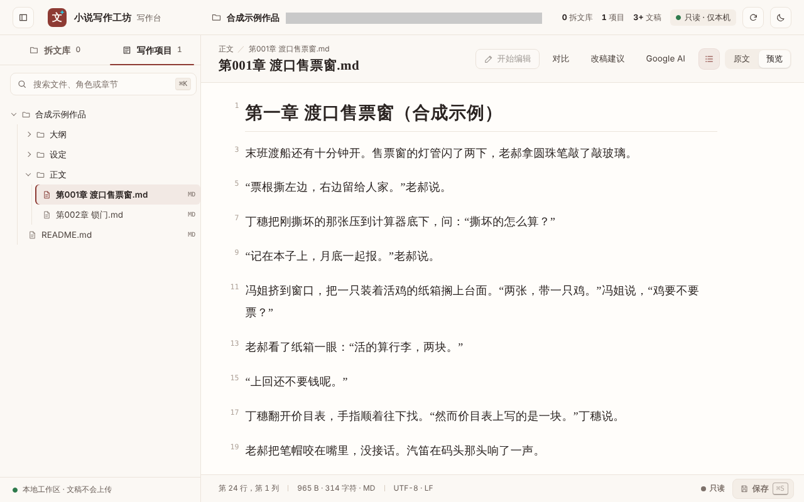

# 实际效果样例

[← 返回首页](../README.md)

这个目录里的每一段脚本输出，都是用工坊包里的脚本在一台机器上真跑出来的，原样保存，一个字没改。输入全是为演示新写的合成文字：第 1 到 7 节是一个渡口售票窗的小场面，三个人（老郝、丁穗、冯姐）；第 8 节是[四个可选模块](../docs/modules.md)一页用的另一份，一个巷口修车摊的小场面，两个人（老秦、阿梨）。它们不是任何人的作品，也不是从哪本小说里摘的。

这里演示的是脚本和流程会做什么，是让 AI 照着做的方法，不是效果保证。工坊只和不用工坊的 AI 比过一次（r5.46，规模小，执行和评审都是同一类模型）：改 AI 腔重的稿子，排第一的都是不用工坊的；从头起草，工坊多数在前。之后没有再比过。对白是不是更像人、更有感情，没有验证；好不好由你读了定。

- 工坊版本：`2026-11-14-r5.55`（商业交付版）。第 4 节（章节门）和第 8 节（四个可选模块）是拿 r5.55 的脚本跑的。第 1、2、3、5、6 节用到的脚本（`dialogue_lines.py`、`prose_lint.py`、`detail_check.py`、`punctuation_lint.py`、`style_cards.py` 和卡库）在 r5.55 里和 r5.54-merged `2026-11-14-r5.54-merged-candidate` 逐字节相同，没有重跑，输出是在 r5.54-merged 上跑的；第 7 节的工作台在 r5.55 里没有改，截图是在 r5.54-merged 上拍的。第 5 节的短表不是脚本输出，是照 r5.54-merged 的 `references/teacher-review.md` 写的；r5.55 改了这一页（放回 r5.54 的几句，短表的“一句话”要写明看的是哪一版初稿，工坊的看法要标明是看法），这张表没有照新页重写。
- 环境：Linux，Python 3.13.17。第 4、8 节 2026-11-14 跑；其余各节 2026-11-13 运行，那一次另有 Node.js 22.22.0。
- 这些脚本输出要完整包加能运行 Python 的环境才有（AI 有执行权限，或者你自己在电脑上跑）。只用便携单文件聊天时没有脚本输出，由 AI 照同样的读法人工做，程序检查一项写“没跑”。
- 命令都在本目录下运行；第 4、8 节除外，那两节的命令在一个工作目录里跑，见那两节。`$NW_SCRIPTS` 指解包以后的 `skills/novel-workshop/scripts`。
- `-I -B` 是 Python 的隔离模式和不写缓存，这台机器上每条命令都带着它跑。你自己跑时不用带 `-I -B`，照[四个可选模块](../docs/modules.md)一页的普通写法。
- 下面的摘录是从输出文件里按行号截的。单独一行的 `……` 表示中间有省略，完整内容看对应文件。首页上的摘录只选了电脑上不用横滑的行，手机上个别长行要横滑。
- 第 1 到 3 节不用开任何模块。第 4 节是默认不开的章节门。第 5 节是教师改稿带回来怎么对照；教师指给你改稿的人：老师、编辑，或者另一个 AI。对照本身不用开，只有登记回传、核对是哪一版初稿那一步要开章节门的“初稿由你转交教师”（r5.55 起开了章节门就默认开着）。第 6、7 节是风格卡和本地工作台。第 8 节是四个可选模块一页拿来演示的那一份：章节门一路走到最终采纳，学习循环、示范记忆和对白声纹检查各走了一遍，四样都默认不开。
- 第 5 节的短表是 Claude（做这些样例的 AI）照规则读完两份稿子写的，不是脚本输出，也没有人确认过；第 7 节是截图。其余都是脚本输出。

| # | 样例 | 输入 | 输出 |
| --- | --- | --- | --- |
| 1 | 台词分栏 | [01-dialogue-lines/scene.md](01-dialogue-lines/scene.md) | [output.txt](01-dialogue-lines/output.txt)、[output-exchanges.txt](01-dialogue-lines/output-exchanges.txt) |
| 2 | 去 AI 味的复核提示 | [before.md](02-deai-hints/before.md)、[after.md](02-deai-hints/after.md) | [before.hint.txt](02-deai-hints/before.hint.txt)、[after.hint.txt](02-deai-hints/after.hint.txt) |
| 3 | 修订前后对照 | 同上两份 | [compare.txt](03-before-after/compare.txt)、[changes.txt](03-before-after/changes.txt) |
| 4 | 章节门 | [events/](04-chapter-gate/events/) | [transcript.txt](04-chapter-gate/transcript.txt)、[status-at-draft.json](04-chapter-gate/status-at-draft.json)、[outputs/](04-chapter-gate/outputs/) |
| 5 | 教师回传短表（AI 写的） | [draft.md](05-teacher-review/draft.md)、[teacher-revision.md](05-teacher-review/teacher-revision.md) | [review-table.md](05-teacher-review/review-table.md)、[tool-outputs/](05-teacher-review/tool-outputs/) |
| 6 | 风格卡 | 卡库（包里自带） | [index-head.txt](06-style-cards/index-head.txt)、[load-hemingway-iceberg.txt](06-style-cards/load-hemingway-iceberg.txt) |
| 7 | 本地工作台截图 | [07-workbench/workspace/](07-workbench/workspace/) | [workbench.png](workbench.png)、[workbench-source.png](07-workbench/workbench-source.png) |
| 8 | 四个可选模块（修车摊） | [run-demo.py](08-modules/run-demo.py)（稿子、事件、配置都写在里面） | [gate/](08-modules/gate/)、[loop/](08-modules/loop/)、[memory/](08-modules/memory/)、[lint/](08-modules/lint/)、[final-words/](08-modules/final-words/) 下的 `transcript.txt` |

## 1. 台词分栏

把一章里的台词按说话人抽出来，一个人一栏，方便你一个人一个人地读。

```bash
python3 -I -B "$NW_SCRIPTS/dialogue_lines.py" 01-dialogue-lines/scene.md --names 老郝,丁穗,冯姐
python3 -I -B "$NW_SCRIPTS/dialogue_lines.py" 01-dialogue-lines/scene.md --names 老郝,丁穗,冯姐 --exchanges
```

输入是一段 244 个汉字的合成稿，写的时候特意放了三样东西：三个人说话，一句没标是谁说的台词，一个进了台词的书面词（“然而”）。

```text
台词分栏：01-dialogue-lines/scene.md（sha256 b3cc483cce58…），台词 10 处
……
== 丁穗，2 处
  第 5 行  “撕坏的怎么算？”
  第 15 行  “然而价目表上写的是一块。”
……
== 叙述里没写明是谁说的，1 处（按上下文自己认）
  第 13 行  “上回还不要钱呢。”
……
== 要再读一遍的，1 处
  第 15 行  “然而价目表上写的是一块。”
      书面词“然而”进了台词：看人物会不会这样说
```

**这说明什么。** 10 句台词，9 句按台词旁边写明的说话人分到了三个人名下。没写是谁说的那一句单独列出来，脚本不猜。丁穗那句里的“然而”被标成要再读一遍的地方。冯姐有两句是按紧挨着的动作认的，输出里也列出来请你回头看一眼。加 `--exchanges` 的那份按先后列出每句台词和它前面那句叙述。

**不说明什么。** 脚本只分栏、只标位置。台词像不像这个人说的、“然而”该不该改，都要你自己读了定。没列出来的地方不等于读者都认得出谁在说。要用 `--names`（或本书的口吻表）告诉它有哪几个人，不给名单它一句也不分。这是一段为演示写的短稿，长稿和更绕的归属写法没有在这里验证。

## 2. 去 AI 味的复核提示

同一个小场面写了两版：一版故意写得套话很重，一版是 Claude 直接改的，没有走工坊流程。两版各跑一次。

```bash
python3 -I -B "$NW_SCRIPTS/prose_lint.py" 02-deai-hints/before.md --hint deai --format text
python3 -I -B "$NW_SCRIPTS/prose_lint.py" 02-deai-hints/after.md --hint deai --format text
```

```text
文字检查：02-deai-hints/before.md（sha256 e1751dff28f4…，非空白字符 250，分段：空行）
结果：要看的 19 处
……
【stock-reaction】现成的身体反应，4 处
  第 3 行：深吸一口气
  第 3 行：嘴角勾起一抹
  第 11 行：心头一紧
  第 11 行：眼眶微微发热
……
【contrast-moral】“不是……而是……”式点题，1 处
  第 11 行：真正的成长不是不再害怕，而是
……
文字检查：02-deai-hints/after.md（sha256 05dc392bfb26…，非空白字符 213，分段：空行）
结果：没有命中（只说明这几条字面规则没命中，不说明文字没问题）
```

**这说明什么。** 改前那版，脚本给出 19 个要回去读的位置，分在 8 条字面规则下面，每条后面带一句怎么看的提示。改后那版，这些规则一条也没碰上。

**不说明什么。** 这只是给出要回去读的位置。脚本自己在输出末尾写着：命中不等于写错，没有命中也不说明写得好或者没有 AI 腔；它不是 AI 检测器。另外还有 7 项可选提示这次没开。改前那版是照着套话故意写的，所以命中多，不代表一般稿子会命中这么多。改后那版是 Claude 自己改的，不是工坊流程在真实稿子上的结果。

## 3. 修订前后对照

拿上面的改前、改后两版，看修订丢了什么、带进来什么。

```bash
python3 -I -B "$NW_SCRIPTS/detail_check.py" compare 02-deai-hints/before.md 02-deai-hints/after.md
python3 -I -B "$NW_SCRIPTS/detail_check.py" changes 02-deai-hints/before.md 02-deai-hints/after.md
```

```text
细节保留核对（原稿 → 修订稿）
- 汉字：原稿 213 字，修订稿 177 字（少 36 字 -17%）
- 原稿里有、修订稿里没了的说法：12 句
  第 1 句「夜色如墨，最后一班渡船缓缓驶离码头，江面被灯光镀上一层淡淡的金色。」：没了“夜色如墨”、“一班渡船缓缓驶离”、“江面被灯光镀上”、“一层淡淡的金色”
……
- 新出现的“X是Y的”判断句（台词外）：1 处
  修订稿第 3 句：“前三天都是老郝做的”
……
- 台词（“”或「」里的话）：改了 1 处，没了 0 处，新加 1 处
  改：原稿第 4 段 “对上了，一分不差。” → 修订稿第 4 段 “对上了。”
  新加：修订稿第 4 段 “撕坏的那张也记了。”
- 数字和数量（带单位或量词的）：没了 1 个，新出现 3 个
```

**这说明什么。** `compare` 列出原稿里有、修订稿里没了的说法（12 句），还在改后那版里标出一句新出现的“X是Y的”判断句。`changes` 逐句列出删的、加的、改的句子，以及变了的台词和数字。改后的稿子它也照样列，不因为是“改好的”就放过。

**不说明什么。** 它只比字面。丢掉的是套话还是有用的细节，要你读了才知道；条数多少不表示改好了还是改坏了。这个例子里丢掉的大多是有意删的套话，所以这份清单在这里更像“删了什么”的流水账。它真正的用处是防止修订时把有用的细节顺手删掉，这一点这个例子没有演示出来。

## 4. 章节门

启用以后，一章要一个阶段一个阶段地走：每个阶段先把成果展示出来，等你确认了，才能进下一个阶段。演示建了一个合成的小项目，从“本章范围”走到“完整初稿”。

写入用 `learning_loop.py apply`，一次一个事件文件；读进度用 `chapter_gate.py status`。这一节的命令不在本目录下直接跑：演示脚本先在一个工作目录里建一份 `learning-record.md` 和 `events/`，再在那个目录里逐条运行下面这样的命令：

```bash
python3 -I -B "$NW_SCRIPTS/learning_loop.py" status learning-record.md
python3 -I -B "$NW_SCRIPTS/learning_loop.py" apply learning-record.md events/01-configure.json \
    --project-id demo-ferry-booth --if-version '上一步返回的 version'
python3 -I -B "$NW_SCRIPTS/chapter_gate.py" status learning-record.md --chapter-id ch01
```

16 条命令和每条的原样输出都在 [transcript.txt](04-chapter-gate/transcript.txt) 里；事件文件在 [events/](04-chapter-gate/events/)。工作目录里的 `learning-record.md` 跑完以后拷了过来，起点和终点分别存成 [learning-record.initial.md](04-chapter-gate/learning-record.initial.md) 和 [learning-record.final.md](04-chapter-gate/learning-record.final.md)。[run-demo.py](04-chapter-gate/run-demo.py) 是为演示写的小脚本，只做三件事：写事件文件，另起进程跑包里的脚本，把打印出来的东西原样存下来。

整套重跑一遍，在本目录下运行（`<工作目录>` 换成一个空目录，结果写在它下面的 `chapter-gate/` 和 `chapter-gate-visual/` 里）：

```bash
python3 -I -B 04-chapter-gate/run-demo.py "$NW_SCRIPTS" <工作目录> 05-teacher-review/draft.md 05-teacher-review/teacher-revision.md
```

走到“完整初稿”时的状态（`status-at-draft.json`），和中途两次被拒绝的输出：

```text
{
  "status": "awaiting_confirmation",
  "chapter_status": "awaiting_confirmation",
  "chapter_id": "ch01",
  "project_id": "demo-ferry-booth",
  "current_stage": "draft",
  "presentation_id": "demo-10-present-draft",
  "presentation_version": "9f14a75e994338415061b2952c01556ff3c5b23e690f2d5928dad1d0c520ce7c",
  "artifact_sha256": "b3cc483cce584b037dd242a5562ff6427f46baf5dd72fb9e261d2bf9b9c4dcf0",
……
  "next_action": "confirm",
……
{"status": "error", "code": "invalid_transition", "message": "Only the current stage may be presented or confirmed"}
……
{"status": "error", "code": "invalid_transition", "message": "Teacher return must bind this chapter's current confirmed draft instance, version and hash"}
```

**这说明什么。**

- 范围、章纲、写前准备各展示一次、确认一次以后，才轮到初稿。状态停在 `draft`，等确认。r5.55 起，状态里多了一栏 `workflow_policy`，写着这一章照项目开头那条 `configure` 走：不要求看图、初稿由你交教师（`basis` 是 `project`）；项目里一条策略都没记的话，两项都会按开着办。
- 范围还没确认就想直接交初稿，被拒绝（第一条 `error`）。
- 往下再走两步：初稿确认以后，状态变成 `await_teacher_return`，等教师的结果回来。拿一个对不上的初稿哈希来登记回传，被拒绝（第二条 `error`）；哈希对得上的回传被记下来，绑在这一版初稿上（展示实例、展示版本和稿件哈希三样都对上）（[outputs/14-teacher-return.txt](04-chapter-gate/outputs/14-teacher-return.txt)）。
- 另一个小项目开了“写前必须有视觉材料”。写前准备不带视觉材料的引用，被拒绝，状态留在 `preparation`（[visual-required/transcript.txt](04-chapter-gate/visual-required/transcript.txt)）。r5.55 的报错写明了这一章照 `visual_required:true` 走，作者说了这一章不看图的，先用 `chapter_policy` 记原话。

**不说明什么。**

- 记录里的“作者原话”全是合成的，是 Claude 为了让脚本走到下一步写的，每一句都标着“合成演示”。脚本核对的是记录之间对不对得上，它认证不了是不是你本人，也分不出原话是真是假。真实使用的时候，这些确认只能来自你本人。
- 拦跳步、拦错版的是脚本，只在装了完整包、AI 能运行 Python 的环境里有（原生 Windows 不行）。只能聊天时由 AI 人工记，没有脚本拦。AI 会不会每一步都老老实实走脚本，没有在真实对话里验证：这里的命令是演示脚本一条一条跑的。
- 它不判断稿子好坏。
- 七个阶段只走了前四个，外加登记回传。审稿、修订稿、最终采纳都没有演示。
- 视觉材料那条链路没有跑：这台机器上没有真的看图，所以主演示没开这一项，只演示了开了以后缺材料会被拦下。
- r5.54-merged 的 `chapter_gate.py status` 在 `-I` 隔离模式下直接跑会报找不到同目录的 `learning_loop`，那一次的演示多了一段把脚本目录加回去的包装。r5.55 修了，这次重跑直接调用它；同一套事件带包装再跑一遍，各条输出和直接调用的逐字节相同。不带 `-I` 的普通写法（`python3 "$NW_SCRIPTS/chapter_gate.py" status …`）没有在这台机器上跑过。

## 5. 教师回传短表（AI 照规则写的，不是脚本输出）

把教师改过的稿子带回来对照，不用先开任何模块；第 4 节里登记回传、核对版本那一步，才要开章节门的“初稿由你转交教师”（r5.55 起开了章节门就默认开着）。

章节门里登记的那份“教师改稿”，对着初稿改了四处：一处错别字，一处台词口气，一处添了查不到依据的事实，一处删了台词。[review-table.md](05-teacher-review/review-table.md) 是照 `references/teacher-review.md` 写出来的短表，完整的八栏在那个文件里。四处的结论：

- **第 1 处，错别字**（初稿第 21 行）。“……**在**把两张票从窗口底下推出去。”改成“……**再**把两张票从窗口底下推出去。”句子通了，没丢什么。拟采纳；工坊核过，你只点例外。
- **第 2 处，台词口气**（初稿第 11 行）。“活的算行李，两块。”改成“按规定，活禽属于行李，要收两块钱。”多了一个完整的句子和“按规定”这个出处，丢了老郝惜字的口气。拟拒绝，保留原句；由你定。
- **第 3 处，添了事实**（初稿第 17 行）。“老郝把笔帽咬在嘴里，没接话。”改成“老郝在这个窗口卖了二十三年票，头一回被新来的当面纠正。他把笔帽咬在嘴里，没接话。”多了两件稿子里原来没有的事，丢了这一处的留白。拟暂缓（待核）；等你给依据或裁决。
- **第 4 处，删了台词**（初稿第 13 行）。“上回还不要钱呢。”整句删去，丢了一句顶回去的话。拟拒绝，保留这句；台词的增删只有你能定。

**这说明什么。** 教师的结果回来以后，工坊交给你的是 review-table.md 那样一张表：原句和教师改句并排，每一处写多了什么、丢了什么，拟采纳、拒绝还是暂缓，依据是什么，这一处谁来定。四处改动四种处理：错别字拟采纳；改平了的口气拟拒绝；查不到依据的事实拟暂缓；删台词不动，只有你能定。表下面照实写了哪些是工具没报、靠读看出来的，哪些没查。

**不说明什么。**

- 这张表是 Claude 读完两份稿子以后写的，不是哪个脚本算出来的。表里引用的脚本输出（[tool-outputs/](05-teacher-review/tool-outputs/)）是真跑的。
- 初稿和“教师改稿”都是合成的，四处改动是特意安排的四种典型情况。真实的教师回传不会这么整齐。包里自己的说明也写着：这套读法还没有用真实的教师回传验证过。
- 表里的判断是一种读法，不是结论。采纳、拒绝、暂缓最后都由你定。
- 演示到出表为止。没有人确认过这张表，也没有做修订和新稿复查。
- 这张表是照 r5.54-merged 的 `references/teacher-review.md` 写的。r5.55 改了这一页：短表的“一句话”要写明看的是哪一版初稿，工坊的看法要标明是看法；这张表没有照新页重写（看的是哪一版初稿，写在表上方，不在“一句话”里）。

## 6. 风格卡

```bash
python3 -I -B "$NW_SCRIPTS/style_cards.py" index | head -n 6
python3 -I -B "$NW_SCRIPTS/style_cards.py" load hemingway-iceberg
```

`index` 的完整输出有 92 行，这里只存了开头 6 行；`load` 的输出完整保存，68 行。

```text
风格卡索引（83 张）。识别由写的人做：对照这一场要读者经历什么、这本书的题材和口吻，每一层挑一张或者不挑（最多 base 1 张、voice 1 张、device 1 张、scene 2 张），对不上就不加载。办法见 references/style-cards.md。
……
## base · 世界观底色（21）
- classical-wuxia-chivalry｜新派冷冽武侠与快意江湖风｜风雨客栈对饮；古道孤客夜行；江湖规矩与恩怨了结；刀剑写意交锋｜不和这几张同用：jinyong-orthodox-wuxia
- cosmic-scifi-sublime｜硬核科幻与深空物理崇高风｜深空航行与天体异象；物理法则打击；高维或巨构建筑观察；极限工程自救
- cyber-wasteland-industrial｜重工废土与赛博机械风｜旧件拆解与义体土法维修；重工业废墟探索；机械故障与过载；高低科技贫富反差
……
# 风格卡：冰山极简与零度白描风（hemingway-iceberg，voice）
……
## 冰山极简与零度白描风（hemingway-iceberg · 整体文风）
……
适用场景：精密操作与机械电气检修；专业人员高速配合；极度克制的情绪压抑；冷酷环境铺垫；战后创伤日常
……
### 叙述逻辑

- 冰山原则：八分之七的情绪藏在水下，多半不解释角色为何沉默或手抖，由读者自行推导。
- 信息多半只给到表面动作，推理大多留给读者完成；关键因果写到读者推得出来的程度。
```

**这说明什么。** 卡库里有 83 张卡，分四层。`index` 列出每张卡的 ID、名字和对得上的场面；`load` 把挑中的卡展开成写这一场的方向，一上来就写明：例句不搬进正文，你自己的文字优先。

**不说明什么。** 脚本不替你挑卡，挑哪张、挑不挑是写的人的判断。加载了卡，不等于写出来就是那个味道。这里没有演示拿卡写出来的正文。

## 7. 本地工作台截图

```bash
NOVEL_WORKSHOP_CONFIG_DIR="<一个空目录>" node "$NW_SCRIPTS/oh-story/dashboard-server.mjs" --root "<合成示例作品的目录>" --port 43110
node 07-workbench/shot-workbench.js http://127.0.0.1:43110 07-workbench/workbench-source.png workbench.png
```



截图是在 r5.54-merged 上拍的；r5.55 没有改工作台（`scripts/oh-story/` 和 `assets/dashboard/` 两边逐字节相同），所以没有重拍。作品目录是 [07-workbench/workspace/](07-workbench/workspace/) 的一份拷贝，里面只有这五个合成文件。`NOVEL_WORKSHOP_CONFIG_DIR` 把工作台的本机配置目录指到一个空目录，免得读到或写到别处。截图用 Playwright 的 Chromium，窗口 1280×800；截完以后服务停掉了。

**这说明什么。** 工作台以只读方式启动以后，可以在浏览器里按“正文、大纲、设定”翻一个作品目录，看原文或者 Markdown 预览。截图过程中，页面没有向这台机器以外的地址发过请求（截图脚本记到的是 0 个）。

**不说明什么。** 只截了只读模式下的两个画面（预览和原文）。开始编辑、保存前备份、对比、改稿建议、Google AI 侧栏都没有演示。截图里工作区的本机路径用灰条遮住了，别的没有动过。这是在没有界面的 Linux 上用 Chromium 截的，不是在 Windows 或 macOS 上双击启动器的效果。

## 8. 四个可选模块（修车摊那一份）

[四个可选模块](../docs/modules.md)一页的最短步骤、试错表和摘出来的返回，都是在这一份材料上跑的：一个巷口修车摊的小场面，两个人（老秦、阿梨），六句台词。稿子、事件和配置都是为那一页新写的合成文字，写在 [run-demo.py](08-modules/run-demo.py) 里。它是为演示写的小脚本，只做三件事：写事件文件或配置，另起进程跑包里的脚本，把打印出来的东西原样存下来；最后一部分是例外，直接调用 `chapter_gate.py` 里最后一关的那道措辞检查，看哪几句记成采纳。

整套重跑一遍，在本目录下运行（`<工作目录>` 换成一个空目录）：

```bash
python3 -I -B 08-modules/run-demo.py "$NW_SCRIPTS" <工作目录>
```

跑完以后 `<工作目录>` 下的各部分，和这里的同名目录一一对应：

| 目录 | 跑了什么 | 命令 |
| --- | --- | --- |
| [gate/](08-modules/gate/) | 章节门：最短四步，接着一路走到最终采纳，中间的试错，第二章先记一条 `chapter_policy` | 45 条 |
| [loop/](08-modules/loop/) | 学习循环：一轮走完、登记示范、读示范、你的采纳和否定意见的试错、另两轮核登记状态、停用 | 52 条 |
| [memory/](08-modules/memory/)、[memory-off/](08-modules/memory-off/)、[memory-noquote/](08-modules/memory-noquote/)、[memory-texthash/](08-modules/memory-texthash/) | 示范记忆：九条合成案例的取法，开关关着时，两份改坏的记录 | 8、1、1、1 条 |
| [lint/](08-modules/lint/) | 对白声纹检查：扫描、补丁请求、应用，和试错 | 12 条 |
| [final-words/](08-modules/final-words/) | 最后一关的措辞检查，五句话 | 1 条 |

每个部分的 `transcript.txt` 按顺序记着每条命令和它的原样输出。命令前面 `$` 那一行是简写：实际都是 `python3 -I -B "$NW_SCRIPTS/<脚本>" …`，在那个部分的目录里运行（`final-words/` 那一条照实写着 `python3 -I -B -c …`）。`events/` 是交上去的事件文件；`lint/` 下是配置、稿子、扫描报告、补丁请求和候选。演示脚本还会在各部分下写出学习记录（`项目/learning-record.md`、`记录.md`）和一个 `outputs/`（每条命令的输出各存一份，内容和 `transcript.txt` 里的相同），这两样这里没有放，重跑就有。

**这说明什么。** 四个可选模块一页上摘的返回、报错和哈希，出自这几份 `transcript.txt`；照上面的命令重跑，能对上。那一页还按步骤讲了每条命令在做什么。

**不说明什么。**

- 记录里的“作者原话”和教师意见都是合成的，标着“合成演示”；最后一关和“你的采纳”那两句带了这几个字脚本就不认，所以合成的字样写在出处一栏。脚本认证不了是谁说的。
- 看图记录是合成字段，没有真的看图；教师回传不是真人的，对白检查的候选改句是手写的，没有让 AI 生成过。
- 只在 Linux、Python 3.13.17 上跑过。
- 它说明脚本照说明工作，不判断稿子好坏。

## 没做的

- 没有用任何真实稿子。全部输入都是合成的，所以这些样例说明的是脚本和流程“会做什么”，不说明它们在你的稿子上效果怎样。
- 第 4 节的章节门只走到登记教师回传；审稿确认、修订稿、最终采纳在第 8 节那份材料上走过。
- 学习循环（记录取舍、改稿、复查）、示范记忆、对白声纹与反模式检查（`dialogue_lint/run_lint.py`）没有在渡口售票窗那份材料上做样例，只在第 8 节的修车摊那份上做过。
- 第 5 节教师回传之后的修订和新稿复查没有做；第 8 节的学习循环在修车摊那份上做过一轮。
- 视觉材料链路没有跑。
- `fact_guard.py` 没有跑。
- 不带 `-I` 的普通 Python 命令没有在这台机器上跑过。
